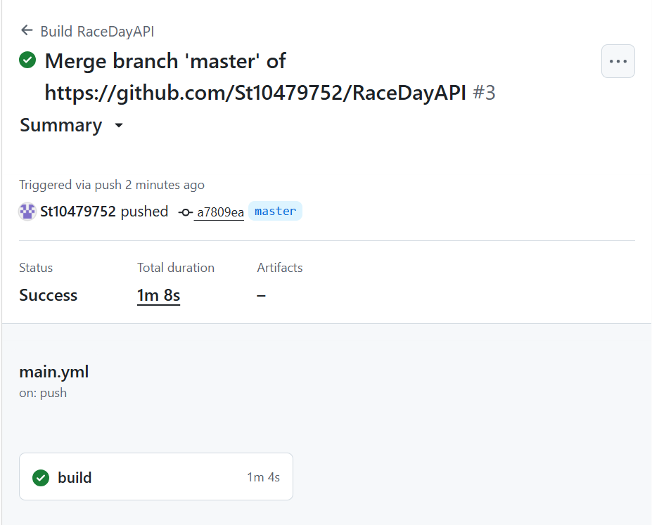

# RaceDayAPI

## Project Description

RaceDayAPI is an ASP.NET Core Web API for managing race day information.

## Technologies Used

* C#
* ASP.NET Core Web API
* SQL Server
* Entity Framework Core
* xUnit
* GitHub Actions

## Build and Test

GitHub Actions automatically builds the project and runs unit tests when changes are pushed to the repository.

## Successful Build

The screenshot of the successful GitHub Actions build will be added to this repository.

